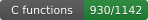
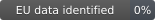
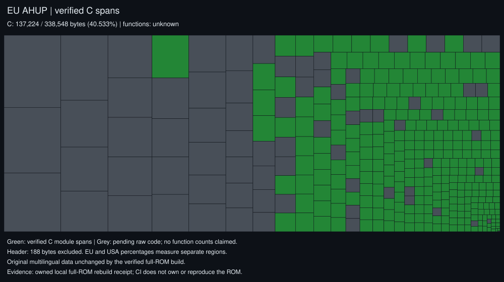
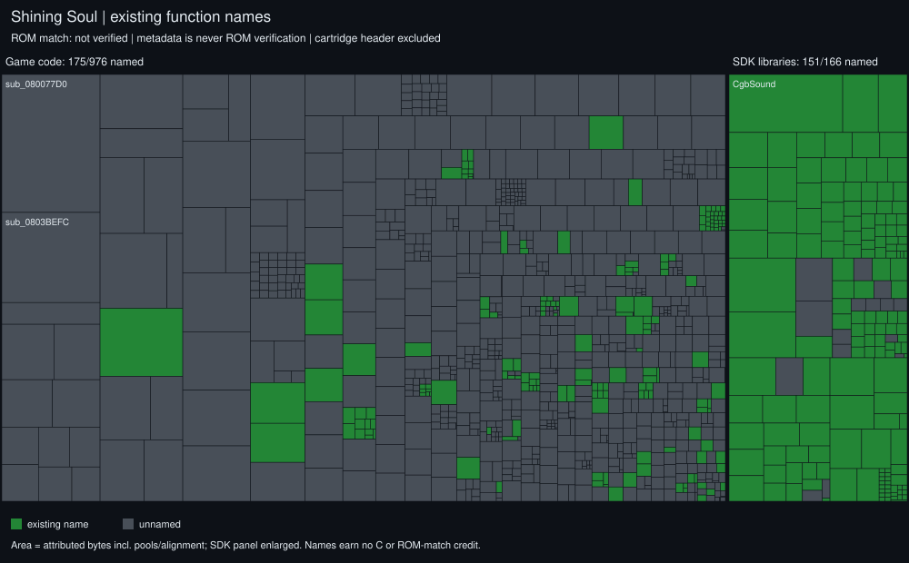
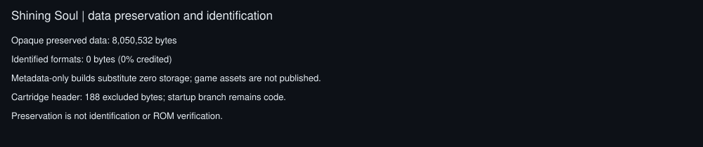

# Shining Soul (USA) decompilation

A work-in-progress decompilation of *Shining Soul* (Game Boy Advance, USA).
The goal is C source that compiles back into a byte-identical ROM.

This fork continues **[emmkay440's original SS1 decompilation](https://github.com/emmkay440/SS1Decomp)**
with his permission. His work and contributions remain credited throughout the
project and derived work. See [credits](CREDITS.md) and the preserved Git history.
Fork maintenance and new contributions: **MatyMeatBoy**.

The continuation also targets the original European multilingual release
(`AHUP`: English, French, German, Italian and Spanish). The existing USA work is
preserved; its source-coverage figures below must not be presented as verified
European coverage. Regional builds and their verification are tracked separately.

## Progress at a glance







The presentation follows [SS2Decomp](https://github.com/MatyMeatBoy/SS2Decomp).
Code, names and data are separate measurements. Green code cells show **linked
C source coverage**; only a successful check against your own ROM establishes
an exact matching build. The ROM-free CI inventory always says **not verified**.

<details open>
<summary><b>Code</b> — which functions are implemented in C?</summary>



Each cell represents a function's attributed linked span, including literal
pools and alignment. Green is linked C, mint is original hand-written assembly,
and grey is pending assembly. SDK code has its own enlarged panel. Aliases at
the same address count once; the 188-byte cartridge header does not count as
executable code. The original 4-byte SDK multiply trampoline is classified with
the library rather than game code.

</details>

<details>
<summary><b>Names</b> — which functions have existing names?</summary>



Existing descriptive symbols are shown separately from anonymous `sub_` names.
This is an inventory, not independent confirmation of every name's meaning, and
names do not earn C or ROM-matching credit.

</details>

<details>
<summary><b>Data</b> — preservation versus identified formats</summary>



Raw data is still supplied by the owner's ROM during a real build. Preserving
that data does not mean its formats have been identified; the initial inventory
credits no data-format identification.

</details>

[Full report](docs/progress/progress.md) · [Machine-readable inventory](docs/progress/progress.json)
· [SS2 reuse candidates](docs/research/SS2_REUSE.md)

Generate these views with `make progress-map` after installing agbcc and ARM
binutils. It builds isolated metadata under `build/metadata/`, substituting zeros
only for the known cartridge-header and opaque-data regions; it never creates a
ROM or modifies ordinary game objects. GitHub Actions regenerates the same views
after updates to `main`. The original `make progress` command below still uses
the actual built ROM and retains its JSON and CSV interface.

The metadata report exposes legacy-compatible byte totals as well as the
header-excluded, separately classified presentation above. A different
denominator is not a newly decompiled function.

**This repository contains no game data.** You need your own copy of the
game. The build pulls everything that isn't code (graphics, music, text,
tables, the cartridge header) out of your ROM at build time, and the
result is checked against the original by SHA1.

| | |
|---|---|
| Game code | `AHUE` |
| ROM SHA1 | `14723ead8634959b4fad027d9618c0860b82ea67` |

## Setup

1. Dump your cartridge (e.g. with a GBxCart RW or GB Operator) and put the ROM
   in this directory as `baserom.gba`. It must match the SHA1 above.
2. Install `arm-none-eabi-binutils` (and `arm-none-eabi-gcc` for its
   preprocessor), `make`, `gcc` and `python3`.
3. Build the tools: `tools/setup.sh`
   (builds [agbcc](https://github.com/pret/agbcc), the GCC 2.95-based compiler
   the game was built with, and [gbadisasm](https://github.com/jiangzhengwenjz/gbadisasm)).
4. `make compare` should print `shiningsoul.gba: OK`.

## Layout

```
asm/            code not yet decompiled (generated by gbadisasm)
asm/lib/        Nintendo SDK libraries: m4a sound, agb_flash, syscalls, libgcc, libc
src/            decompiled C (each file replaces an asm/ module in ld_script.ld)
src/lib/        decompiled Nintendo SDK C (m4a.c, built with old_agbcc)
include/        headers
data/data.s     everything after the code (0x0805289C-end), incbin'd from baserom.gba
config/         names.txt (functions), ram_symbols.txt (RAM variables),
                rom_symbols.txt (ROM tables), io_regs.txt
ld_script.ld    link order; picks asm/<x>.o or src/<x>.o for each module
tools/scripts/  helper scripts (below)
tools/ghidra/   Ghidra scripts for a matching Ghidra project
```

## ROM map

| Range | Contents |
|---|---|
| `08000000-080000C0` | entry branch + cartridge header (from baserom) |
| `080000C0-0800023C` | crt0, `IntrMain` (ARM, copied to IWRAM) |
| `0800023C-0804FAAC` | game code |
| `0804FAAC-08051B90` | m4a / MusicPlayer2000 sound engine |
| `08051B90-08051BD4` | BIOS call wrappers |
| `08051BD4-08052544` | Flash save library `FLASH512_V131` |
| `08052544-0805289C` | libgcc, newlib (`bzero`, `memcpy`) |
| `0805289C-` | data |

## Decompiling a function

1. Pick a group of functions and carve it out into its own module:
   `tools/scripts/split_asm.py asm/code.s FirstFunc NextFunc module_name`.
   This creates `asm/module_name.s` and adds it to `ld_script.ld` in link order.
2. Write `src/module_name.c`. The Ghidra output is a good starting point, but it
   needs rewriting until agbcc produces the exact same instructions.
3. In `ld_script.ld`, change `asm/module_name.o` to `src/module_name.o`. Run
   `make compare`. When it matches, delete `asm/module_name.s`.

`src/copy_queue.c` is a worked example.

## Checking progress

| Command | Tells you |
|---|---|
| `make compare` | built ROM is byte-identical to the original |
| `make progress` | % of game code in C, functions named, data identified (`RECORD=1` logs to `progress.csv`) |
| `make diff` | which functions differ after a change broke matching, and where code shifted |
| `make check FUNC=Name` | instruction diff of one function against the original |

## Research (finding out what functions do)

See [docs/RESEARCH.md](docs/RESEARCH.md): play in mGBA while
`tools/research/trace.py` records which functions run per activity, and
`tools/research/watch.py` reports which functions change a RAM value.

## Naming

- `tools/scripts/rename.py sub_08001970 GameMain`: renames a symbol everywhere and
  records it in `config/names.txt`.
- Add RAM variables to `config/ram_symbols.txt`, then run
  `tools/scripts/apply_syms.py`, which also regenerates `ld_symbols.ld`.
- Names for the sound and flash libraries were found by matching this ROM against
  [pokeemerald](https://github.com/pret/pokeemerald)'s m4a and agb_flash sources
  (compiled with agbcc, relocations masked). Engine names come from reading
  the code. Treat any name you can't verify as a guess and say so in a comment.

## Ghidra

Create a project from your own ROM, then apply the repo's names:

```
analyzeHeadless <proj_dir> ShiningSoul -import baserom.gba \
  -loader BinaryLoader -loader-baseAddr 0x08000000 -processor ARM:LE:32:v4t \
  -scriptPath tools/ghidra -preScript GbaSetup.java \
  -postScript GbaPass2.java 0x0805289C -postScript GbaPass3.java \
  -postScript ImportNames.java "$PWD"
```

Re-run with `-process baserom.gba -noanalysis -postScript ImportNames.java "$PWD"`
after renaming things.
