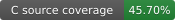
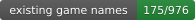
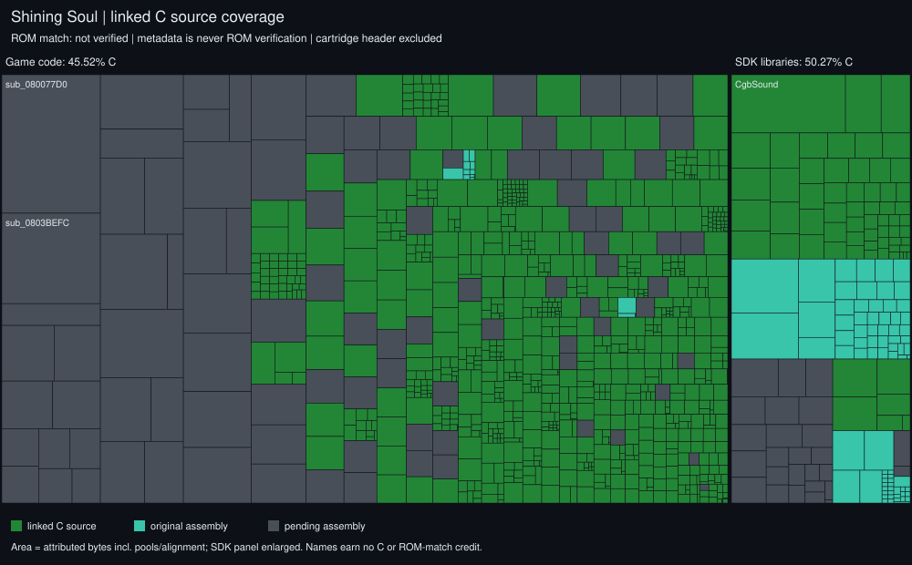

# SS1Decomp — Shining Soul

A work-in-progress decompilation of *Shining Soul* (Game Boy Advance), preserving
the original USA work and the European multilingual release.
The goal is C source that compiles back into a byte-identical ROM.

This fork continues **[emmkay440's original SS1 decompilation](https://github.com/emmkay440/SS1Decomp)**
with his permission. His work and contributions remain credited throughout the
project and derived work. See [credits](CREDITS.md) and the preserved Git history.
Fork maintenance and new contributions: **MatyMeatBoy**.

The continuation also targets the original European multilingual release
(`AHUP`: English, French, German, Italian and Spanish). The existing USA work is
preserved; its source-coverage figures below must not be presented as verified
European coverage. Regional builds and their verification are tracked separately.

## Progress — Europe (AHUP)


The primary profile is the owner's original European multilingual ROM. The
presentation follows [SS2Decomp](https://github.com/MatyMeatBoy/SS2Decomp), with
code, names and data measured separately.

<details open>
<summary><b>Code</b> — verified C versus pending raw code</summary>


Green cells are complete C modules that reproduce their European byte spans.
Grey cells remain raw pending code, not credited disassembly. Area includes
literal pools and alignment; the 188-byte cartridge header is excluded. The
complete regional function count is not yet measured.

The first verified cohort (2026-11-12) contains **292 C modules**, covering
**137,224 / 338,548 code bytes (40.533%)**. All 8 MiB rebuilt exactly, including
the original language selector and multilingual assets. The badges and generated
report carry the current result; this cohort is a historical checkpoint.

</details>

<details>
<summary><b>Names</b> — regional inventory still to be measured</summary>


Shared C modules retain source symbols, but a complete independently identified
European function inventory has not been established. No USA naming percentage
or invented function denominator is applied to Europe.

</details>

<details>
<summary><b>Data</b> — preserved original assets, format credit separate</summary>


Original data remains byte-identical in the verified rebuild. Preservation does
not earn format-identification credit; the initial report credits zero bytes.
No game assets are distributed here.

</details>

[Current EU report](docs/progress/progress.md) · [Machine-readable result](docs/progress/progress.json)
· [Regional workflow](docs/REGIONS.md) · [SS2 reuse candidates](docs/research/SS2_REUSE.md)

The [verification receipt](config/regions/eu_verified.json) contains source hashes
and span evidence only. CI checks that those inputs remain current; it does not
possess or rebuild the owner's ROM. Changed or incomplete inputs invalidate the
recorded credit. `make progress` performs the actual EU gate with your ROM;
`make progress-map` regenerates the public views without a ROM.

## USA reference (secondary)

<details>
<summary>Preserved upstream source inventory — separate from Europe</summary>








Green shows linked C source coverage, not a newly verified USA ROM. The existing
USA sources are preserved. Header bytes are excluded, aliases count once and
SDK code is separate. Legacy-compatible byte totals remain in the report.
Names and preserved opaque data do not earn C or ROM-match credit.

[USA inventory](docs/progress/usa/progress.md) · [USA JSON](docs/progress/usa/progress.json)

Use `make REGION=us compare` or `make compare-us` with your own AHUE ROM. The
original USA `progress.py --json` and CSV interface remain available through
`make progress-us`.

</details>

**This repository contains no game data.** You need your own copy of the
game. The build pulls everything that isn't code (graphics, music, text,
tables, the cartridge header) out of your ROM at build time, and the
result is checked against the original by SHA1.

## European multilingual build

Place your own original European dump in this directory as `baserom_eu.gba`.
It must be 8 MiB, game code `AHUP`, SHA1
`6e80a65cca65236e405940c880b144d77f3f4f08`. Then run:

```sh
make compare-eu
```

This compiles isolated source objects, finds strict relocation-aware whole-module
matches, links the proven C modules at their European addresses and preserves
all other original bytes as pending raw spans. Credit is granted only after the
complete rebuilt ROM is byte-identical and its SHA1 matches. Nothing is patched
to pretend the European cartridge is the USA version.

`make record-eu` runs that same full gate, then updates the text-only receipt.
Stage the source changes and receipt together; never stage the ROM or objects.
The USA source recipes remain available explicitly with `REGION=us`.

## USA setup

| | |
|---|---|
| Game code | `AHUE` |
| ROM SHA1 | `14723ead8634959b4fad027d9618c0860b82ea67` |


1. Dump your cartridge (e.g. with a GBxCart RW or GB Operator) and put the ROM
   in this directory as `baserom.gba`. It must match the SHA1 above.
2. Install `arm-none-eabi-binutils` (and `arm-none-eabi-gcc` for its
   preprocessor), `make`, `gcc` and `python3`.
3. Build the tools: `tools/setup.sh`
   (builds [agbcc](https://github.com/pret/agbcc), the GCC 2.95-based compiler
   the game was built with, and [gbadisasm](https://github.com/jiangzhengwenjz/gbadisasm)).
4. `make REGION=us compare` should print `shiningsoul.gba: OK`.

## Layout

```
asm/            code not yet decompiled (generated by gbadisasm)
asm/lib/        Nintendo SDK libraries: m4a sound, agb_flash, syscalls, libgcc, libc
src/            decompiled C (each file replaces an asm/ module in ld_script.ld)
src/lib/        decompiled Nintendo SDK C (m4a.c, built with old_agbcc)
include/        headers
data/data.s     everything after the code (0x0805289C-end), incbin'd from baserom.gba
config/         names.txt (functions), ram_symbols.txt (RAM variables),
                rom_symbols.txt (ROM tables), io_regs.txt
ld_script.ld    link order; picks asm/<x>.o or src/<x>.o for each module
tools/scripts/  helper scripts (below)
tools/ghidra/   Ghidra scripts for a matching Ghidra project
```

## ROM map

| Range | Contents |
|---|---|
| `08000000-080000C0` | entry branch + cartridge header (from baserom) |
| `080000C0-0800023C` | crt0, `IntrMain` (ARM, copied to IWRAM) |
| `0800023C-0804FAAC` | game code |
| `0804FAAC-08051B90` | m4a / MusicPlayer2000 sound engine |
| `08051B90-08051BD4` | BIOS call wrappers |
| `08051BD4-08052544` | Flash save library `FLASH512_V131` |
| `08052544-0805289C` | libgcc, newlib (`bzero`, `memcpy`) |
| `0805289C-` | data |

## Decompiling a function

The original split/check tools below describe the preserved USA source tree.
Use `REGION=us` for its build/check commands. European shared-module work follows
[the regional workflow](docs/REGIONS.md) and the full AHUP comparison gate.

1. Pick a group of functions and carve it out into its own module:
   `tools/scripts/split_asm.py asm/code.s FirstFunc NextFunc module_name`.
   This creates `asm/module_name.s` and adds it to `ld_script.ld` in link order.
2. Write `src/module_name.c`. The Ghidra output is a good starting point, but it
   needs rewriting until agbcc produces the exact same instructions.
3. In `ld_script.ld`, change `asm/module_name.o` to `src/module_name.o`. Run
   `make compare`. When it matches, delete `asm/module_name.s`.

`src/copy_queue.c` is a worked example.

## Checking progress

| Command | Tells you |
|---|---|
| `make compare` | full European ROM is byte-identical to the owned AHUP original |
| `make compare-us` | original USA build is byte-identical to the AHUE original |
| `make progress` | verify and show European progress |
| `make progress-us` | original USA code/names/data inventory (`RECORD=1` logs CSV) |
| `make REGION=us diff` | USA backend: which functions differ and where code shifted |
| `make REGION=us check FUNC=Name` | USA backend: instruction diff of one function |

## Research (finding out what functions do)

See [docs/RESEARCH.md](docs/RESEARCH.md): play in mGBA while
`tools/research/trace.py` records which functions run per activity, and
`tools/research/watch.py` reports which functions change a RAM value.

## Naming

- `tools/scripts/rename.py sub_08001970 GameMain`: renames a symbol everywhere and
  records it in `config/names.txt`.
- Add RAM variables to `config/ram_symbols.txt`, then run
  `tools/scripts/apply_syms.py`, which also regenerates `ld_symbols.ld`.
- Names for the sound and flash libraries were found by matching this ROM against
  [pokeemerald](https://github.com/pret/pokeemerald)'s m4a and agb_flash sources
  (compiled with agbcc, relocations masked). Engine names come from reading
  the code. Treat any name you can't verify as a guess and say so in a comment.

## Ghidra

The following commands and symbol addresses describe the USA reference profile.

Create a project from your own ROM, then apply the repo's names:

```
analyzeHeadless <proj_dir> ShiningSoul -import baserom.gba \
  -loader BinaryLoader -loader-baseAddr 0x08000000 -processor ARM:LE:32:v4t \
  -scriptPath tools/ghidra -preScript GbaSetup.java \
  -postScript GbaPass2.java 0x0805289C -postScript GbaPass3.java \
  -postScript ImportNames.java "$PWD"
```

Re-run with `-process baserom.gba -noanalysis -postScript ImportNames.java "$PWD"`
after renaming things.
